# BigScreen

[](https://github.com/clioscott/bigscreen/actions/workflows/ci.yml)
[](LICENSE)


A home-built **448 × 192 RGB LED wall**: 21 HUB75 panels (64 × 64 each) driven by a Raspberry Pi 4 at a steady
120 Hz refresh. It shows my calendar, the weather, live radar and satellite loops, headlines and a stock ticker.
When something actually matters around Vancouver, it turns into a full-wall alert screen: Environment Canada
warnings, Alert Ready broadcasts, earthquakes (with live seismometers), tsunamis, wildfires and road closures.

Everything is drawn pixel by pixel in real bitmap fonts at their native size. No scaled text, no anti-aliasing,
just LEDs.

<p align="center">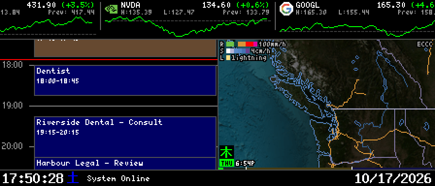</p>

<sub>Every screenshot and animation in this README is rendered by the display's own code (`python -m tools.readme
media`) from built-in samples and synthetic calendar and ticker data, so it matches the wall pixel for pixel.</sub>

## Contents

- [How it works](#how-it-works)
- [Features](#features)
- [Gallery](#gallery)
- [The build](#the-build)
- [Running it](#running-it)
- [Development workflow](#development-workflow)
- [Credits](#credits)

## How it works

The Pi only renders. Everything that talks to the internet runs on a small home server (the *hub*). The hub writes
plain JSON and pre-rendered map animations, and after every successful fetch it rsyncs them to a tmpfs on the Pi.

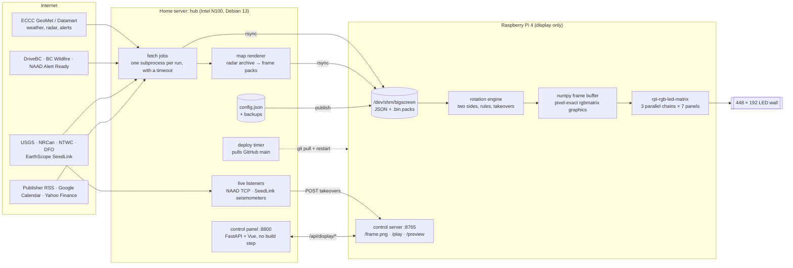

**On the Pi** (`display/`), each frame is drawn into a numpy buffer by `display/gfx.py`. It re-implements
rpi-rgb-led-matrix's `graphics` module pixel for pixel, down to the same BDF parsing quirks and line algorithm.
Only the 64 × 16 tiles that changed go to the panels, in one C++ call (`FrameCanvas.SetBuffer`, a method this
project patches into the library's Python binding). The render thread and the library's refresh thread each get
an isolated core (`isolcpus=2,3`), so the panels don't flicker even while radar plays.

**The wall has two sides**, and each runs its own rotation of screens (`display/rotation.py`). A screen always plays
to its end. Rules (`display/rules.py`: time of day, weekday, "an alert is active", "it's raining") are checked only
when the next screen is picked. Alerts take over the whole wall. A *new* alert jumps the queue and plays every
page. It stays full-wall for a few showings, then moves to a half-width card on the right side.

**On the server** (`hub/`), a scheduler runs each fetch as a short-lived subprocess with a timeout, records its
health in `status.json` and syncs the data to the Pi. Two long-running listeners push takeovers straight to the
display when something happens: the NAAD Alert Ready TCP feed, and 35 seismometer channels over SeedLink.

**The control panel** (port 8800) edits a single `config.json`, with live previews rendered by the display's own
code. It covers every alert theme, every BC screen, the rotation, map areas, colour scales and fonts. Saves
hot-reload on the wall, no restart needed.

## Features

<!-- gen:features -->
- **13 weather-alert themes** built from 13 layouts, 17 font families and 11 palettes.
- **Alert Ready**: 4 themes (Alert Ready broadcast, Phone alert, CAP teletype, Provincial bulletin), 4 built-in samples.
- **DriveBC**: 6 themes (Incident map, Shield headline, Overhead sign, Metro overview, Highway camera, Traffic desk), 4 built-in samples.
- **Earthquakes**: 4 themes (Network map, ShakeMap, Earthquake report, Early warning), 5 built-in samples.
- **Tsunami**: 4 themes (North Pacific, BC zones, Bulletin, Hazard sign), 3 built-in samples.
- **Wildfire**: 4 themes (Situation map, Incident card, Fire danger sign, Evacuation notice), 3 built-in samples.
- **Japan EEW**: 12 themes (Kyoshin Monitor, JQuake style, TV broadcast, LED countdown, Departure board, Pachinko, Fever mode, Data terminal, 号外 extra edition, Seismograph lab, Arcade cabinet, Instrument panel).
- **15 fetch jobs** on the hub, each a short-lived subprocess with a timeout:
  - `alerts`: Current ECCC alerts for the configured area → data/alerts.json
  - `bridges`: Bridges now: the latest DriveBC still from a camera on each Metro Vancouver bridge → data/bridges.json + tiles
  - `calendar`: Google Calendar events → data/calendar.json (v1 format, via the v1 CalendarService)
  - `drivebc`: Road incidents and closures in Metro Vancouver → data/drivebc.json (+ webcam stills)
  - `finance`: Stock + crypto quotes via yfinance — one fetch per process
  - `maps`: Keep the radar archive current, then re-render tracks that are due
  - `naad`: The stored NAAD messages (hub/bc/naad_listener.py) → data/naad.json
  - `news`: Headlines from publisher RSS/Atom feeds, grouped into categories
  - `quakes`: Quakes that matter in south-west BC → data/quakes.json
  - `shield_signs`: The real highway signs the webcam captions use → data/shields/*.png (hub/shield_signs.py)
  - `timezones`: Time zone map: US/Canada offsets for a year from the newest tzdata, plus map rasters → data/tzmap.json
  - `tsunami`: NTWC bulletins for the BC coast → data/tsunami.json
  - `weather`: Environment Canada citypage forecast + SWOB live observations → data/weather.json
  - `webcam_weather`: Weather and sunrise/sunset at each webcam → data/webcam_weather.json (for the webcam captions)
  - `wildfire`: BC Wildfire Service data for south-west BC and the Okanagan → data/wildfire.json
- **438 bitmap fonts**, always drawn at native size ([credits](assets/fonts/CREDITS.md)).
<!-- /gen:features -->

**Live webcams**: video from YouTube live streams or any HLS / MJPEG / RTSP camera, as a rotation screen on one side,
full width or the whole wall. The hub decodes each stream with ffmpeg (yt-dlp finds the video behind a YouTube page) and
sends the Pi frames already cropped to its zone, so the Pi never decodes video. Each webcam keeps its own crop for every
place on the wall, colour adjustments, and a caption in one of twelve layouts (lower third, split bar with a big clock,
world clock, departure board, ticker, chips and more) built from the sections you pick and order: name, place, local
time, weather and sunrise/sunset at the camera (Open-Meteo), date, time difference, your own line and who runs the
camera. A ready-made gallery of about a hundred 24/7 streams (Vancouver, Calgary, Toronto, Seattle, San Francisco, New
York, Boston and more) can be browsed by city and kind, as a grid or on a map. DriveBC's highway cameras are there too
(by bridge and tunnel, by city, or on a map), shown as stills with the exact time each picture was taken. Set up on the
control panel's Webcams page, with a live preview of exactly what the wall will show.

## Gallery

<!-- gen:gallery -->
### The wall

<table>
<tr><td align="center" valign="top">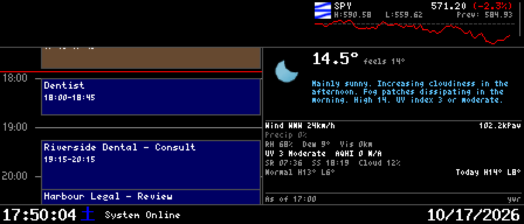<br><sub><b>Calendar + weather</b></sub></td></tr>
<tr><td align="center" valign="top">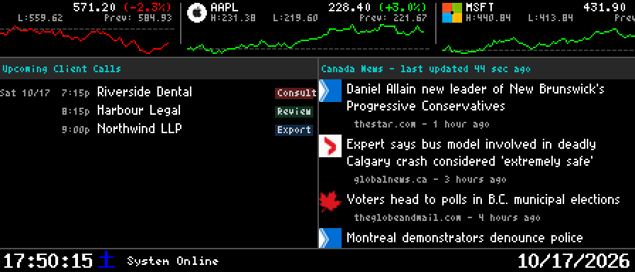<br><sub><b>Client calls + headlines</b></sub></td></tr>
<tr><td align="center" valign="top"><br><sub><b>Calendar + radar</b></sub></td></tr>
<tr><td align="center" valign="top">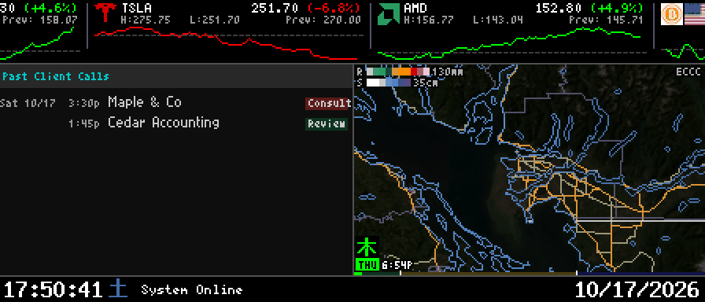<br><sub><b>Past calls + rain totals</b></sub></td></tr>
</table>

### Weather maps

Radar, rolling rain/snow totals and satellite loops, rendered on the server and played back frame-exact on the Pi.

<table>
<tr><td align="center" valign="top">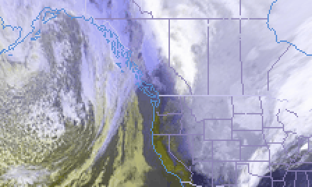<br><sub><b>GOES-West</b><br>286 frames</sub></td><td align="center" valign="top">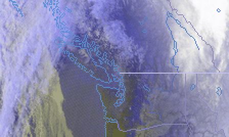<br><sub><b>GOES-West (PNW)</b><br>286 frames</sub></td></tr>
<tr><td align="center" valign="top">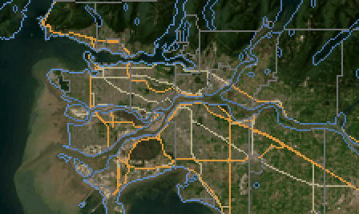<br><sub><b>Metro Vancouver Rain Accum.</b><br>480 frames</sub></td><td align="center" valign="top"><br><sub><b>Radar(Fcst)</b><br>43 frames</sub></td></tr>
<tr><td align="center" valign="top">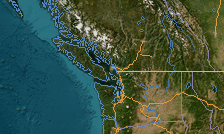<br><sub><b>Radar(Live)</b><br>491 frames</sub></td><td align="center" valign="top">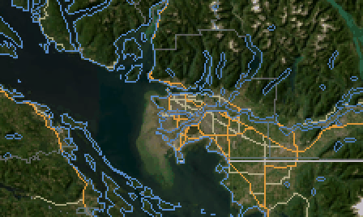<br><sub><b>Radar(Accum)</b><br>480 frames</sub></td></tr>
</table>

### Weather alerts (ECCC)

One animation per layout, then every theme.

<table>
<tr><td align="center" valign="top">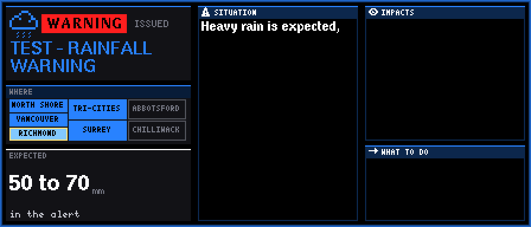<br><sub><b>Console</b><br>Fact column · Helvetica &amp; Lucida · Blackout · Slow pulse · Line by line</sub></td><td align="center" valign="top">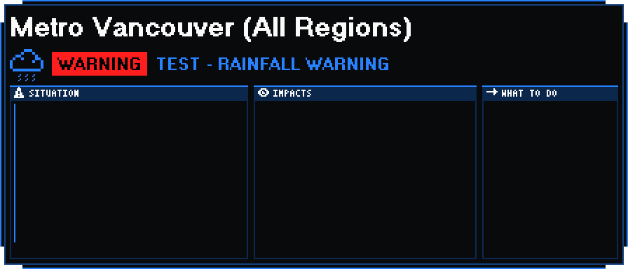<br><sub><b>Headline</b><br>Where-first headline · Crox sans · Graphite · Double rule · Wipe</sub></td></tr>
<tr><td align="center" valign="top">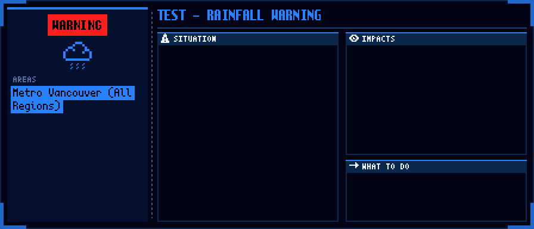<br><sub><b>Ticket</b><br>Ticket stub · Kakwa &amp; Curie · Midnight · Corner brackets · Sections slide in</sub></td><td align="center" valign="top">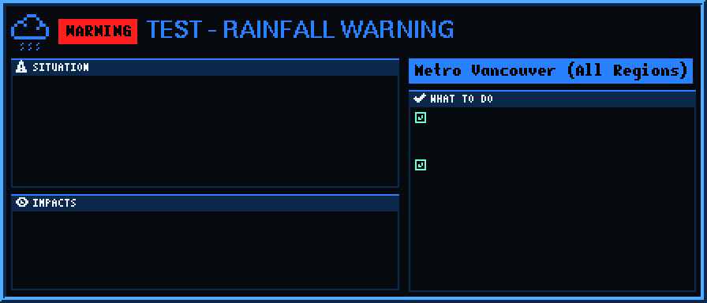<br><sub><b>Checklist</b><br>Checklist · Schumacher Clean · Slate · Bevel · Cascade</sub></td></tr>
<tr><td align="center" valign="top">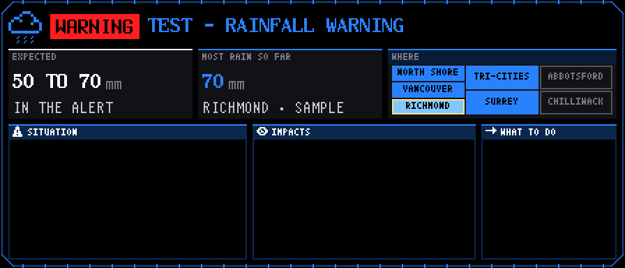<br><sub><b>Big Numbers</b><br>Big numbers · Terminus · Blackout · Notched tech frame · Cascade</sub></td><td align="center" valign="top">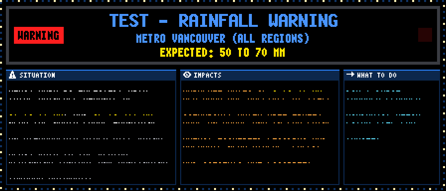<br><sub><b>Overhead Sign</b><br>Overhead sign · Neep · Blackout · Chasing lights · Blinds</sub></td></tr>
<tr><td align="center" valign="top">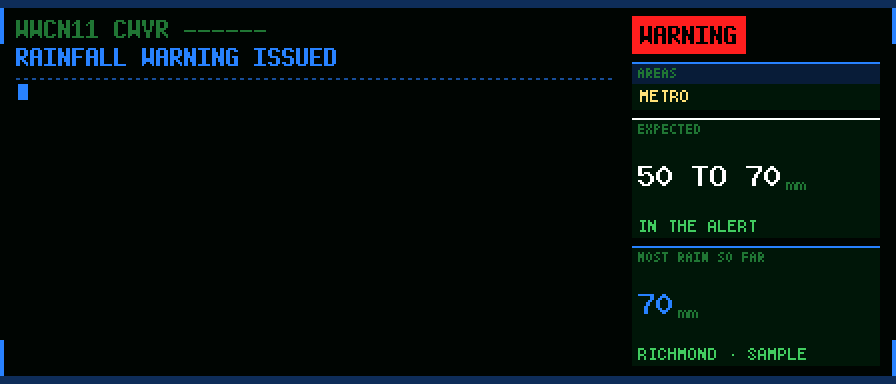<br><sub><b>Teletype</b><br>Wire bulletin · X11 fixed · Phosphor · Scan bars · Typewriter</sub></td><td align="center" valign="top">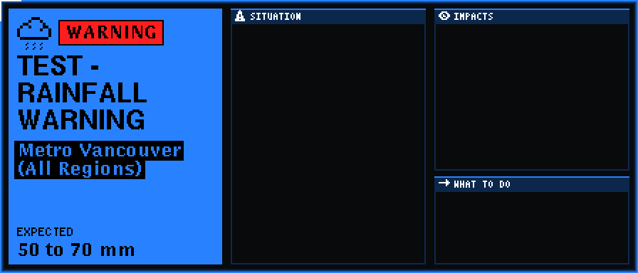<br><sub><b>Colour Block</b><br>Colour block · Helvetica &amp; Lucida · Graphite · Glow · Fade in</sub></td></tr>
<tr><td align="center" valign="top">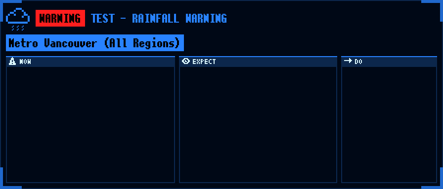<br><sub><b>Now Expect Do</b><br>Now / Expect / Do · M+ Latin · Cyanotype · Corner brackets · Sections slide in</sub></td><td align="center" valign="top">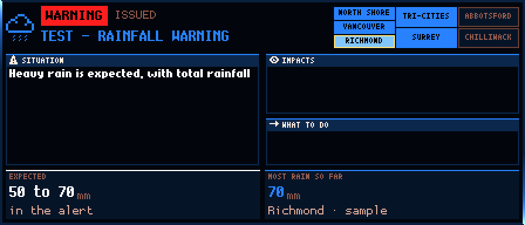<br><sub><b>Strip</b><br>Grid header + number bar · Dina &amp; ctrld · Oxide (weather-tinted) · Comet · Line by line</sub></td></tr>
<tr><td align="center" valign="top">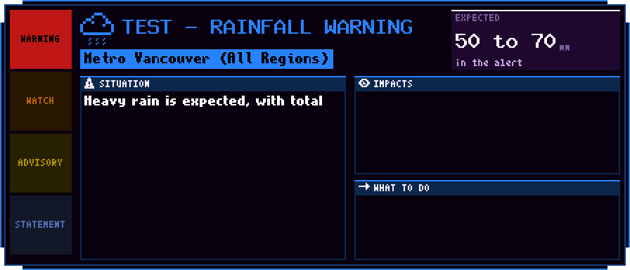<br><sub><b>Level Rail</b><br>Level rail · Gohu &amp; Tewi · Violet hour · Double rule · Line by line</sub></td><td align="center" valign="top">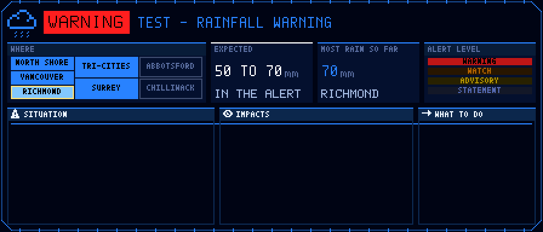<br><sub><b>Instrument Deck</b><br>Instrument deck · Envy Code &amp; Haxor · Midnight · Notched tech frame · Scan bar</sub></td></tr>
<tr><td align="center" valign="top">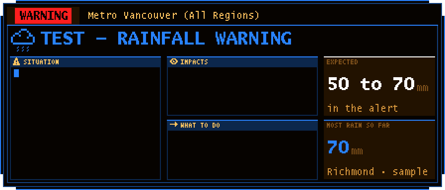<br><sub><b>Case File</b><br>Case file · Lucida Typewriter · Sodium lamp · Double rule · Typewriter</sub></td></tr>
</table>

<details><summary>All alert themes</summary>

<table>
<tr><td align="center" valign="top">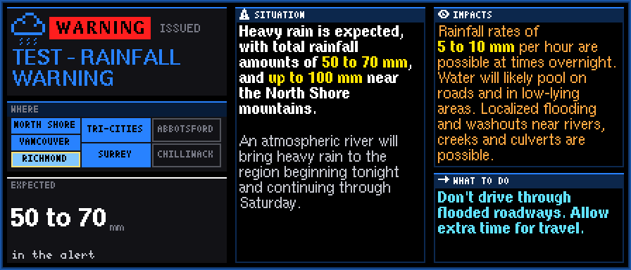<br><sub><b>Console</b><br>Fact column · Helvetica &amp; Lucida · Blackout · Slow pulse · Line by line</sub></td><td align="center" valign="top">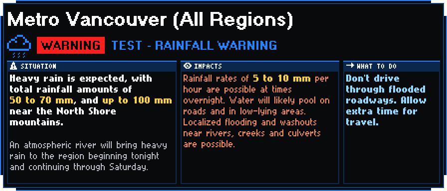<br><sub><b>Headline</b><br>Where-first headline · Crox sans · Graphite · Double rule · Wipe</sub></td><td align="center" valign="top">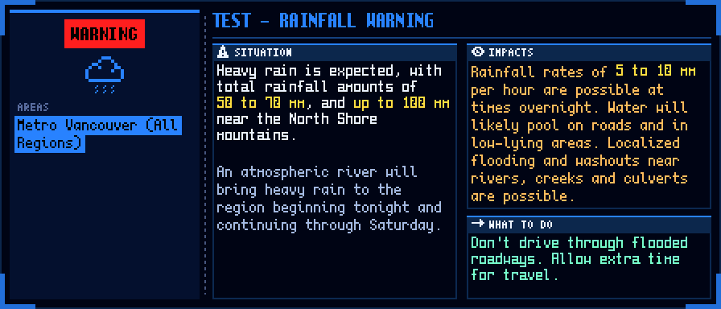<br><sub><b>Ticket</b><br>Ticket stub · Kakwa &amp; Curie · Midnight · Corner brackets · Sections slide in</sub></td></tr>
<tr><td align="center" valign="top">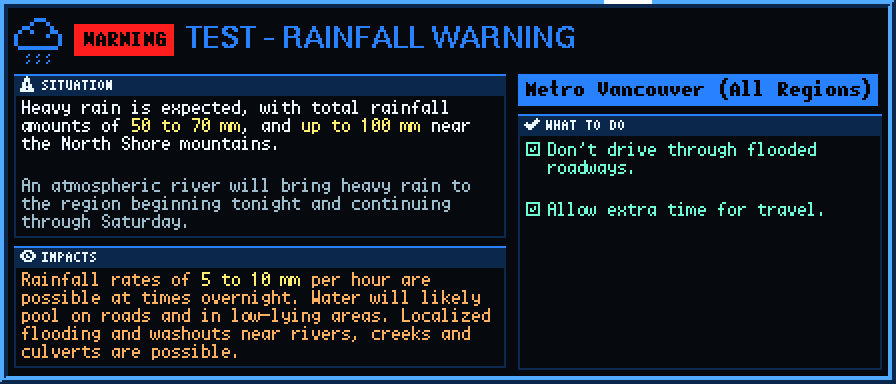<br><sub><b>Checklist</b><br>Checklist · Schumacher Clean · Slate · Bevel · Cascade</sub></td><td align="center" valign="top">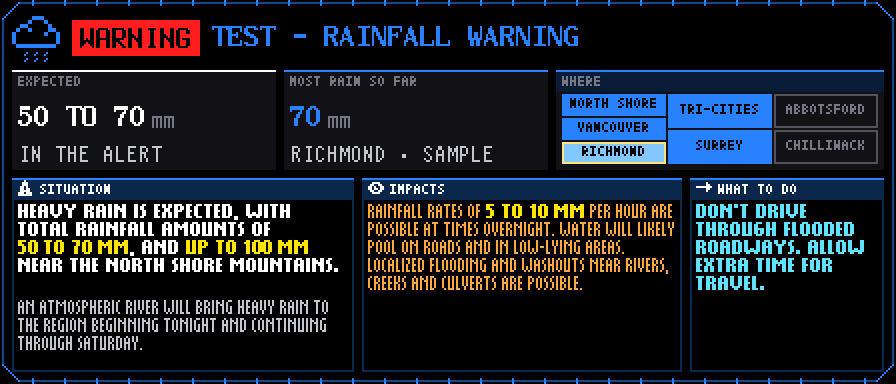<br><sub><b>Big Numbers</b><br>Big numbers · Terminus · Blackout · Notched tech frame · Cascade</sub></td><td align="center" valign="top">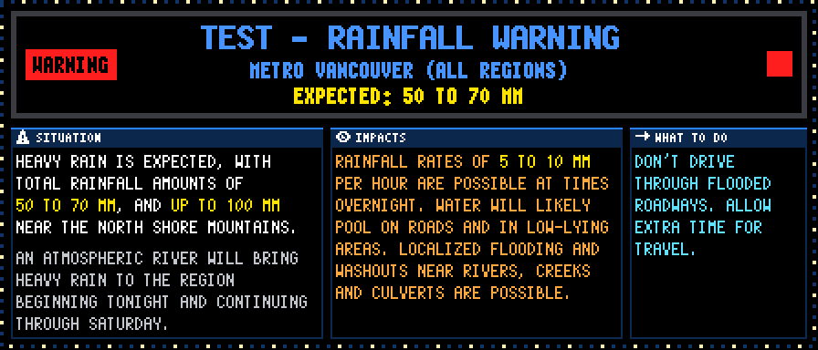<br><sub><b>Overhead Sign</b><br>Overhead sign · Neep · Blackout · Chasing lights · Blinds</sub></td></tr>
<tr><td align="center" valign="top">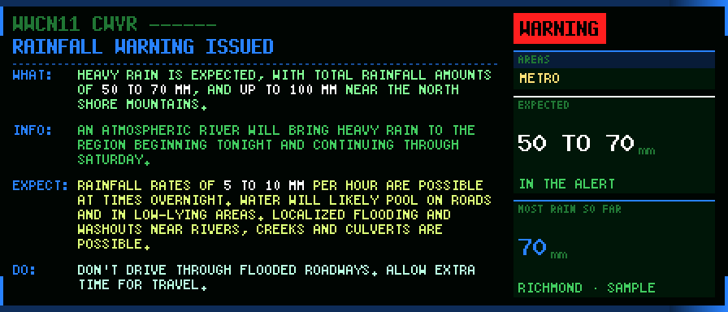<br><sub><b>Teletype</b><br>Wire bulletin · X11 fixed · Phosphor · Scan bars · Typewriter</sub></td><td align="center" valign="top">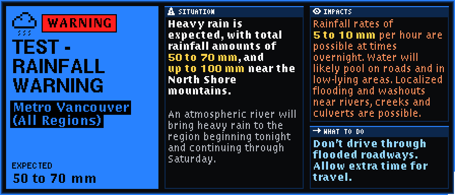<br><sub><b>Colour Block</b><br>Colour block · Helvetica &amp; Lucida · Graphite · Glow · Fade in</sub></td><td align="center" valign="top">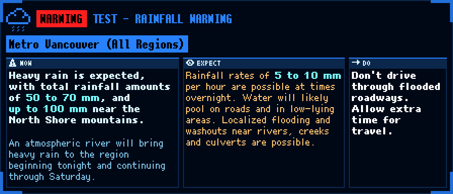<br><sub><b>Now Expect Do</b><br>Now / Expect / Do · M+ Latin · Cyanotype · Corner brackets · Sections slide in</sub></td></tr>
<tr><td align="center" valign="top">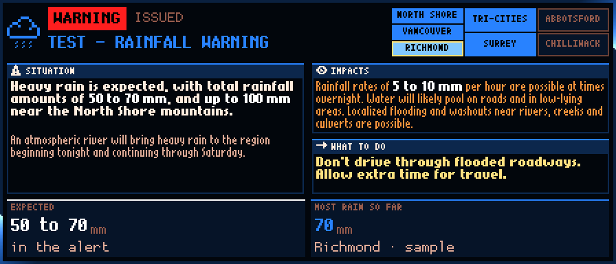<br><sub><b>Strip</b><br>Grid header + number bar · Dina &amp; ctrld · Oxide (weather-tinted) · Comet · Line by line</sub></td><td align="center" valign="top">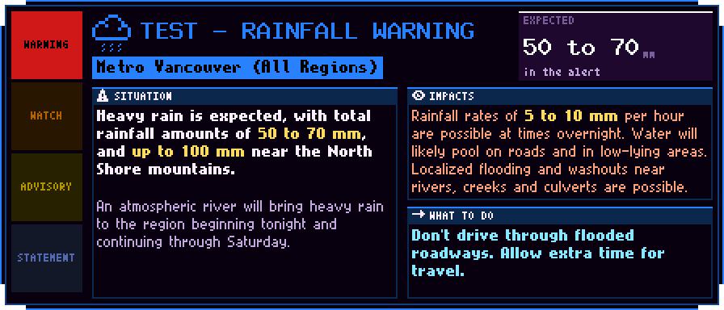<br><sub><b>Level Rail</b><br>Level rail · Gohu &amp; Tewi · Violet hour · Double rule · Line by line</sub></td><td align="center" valign="top">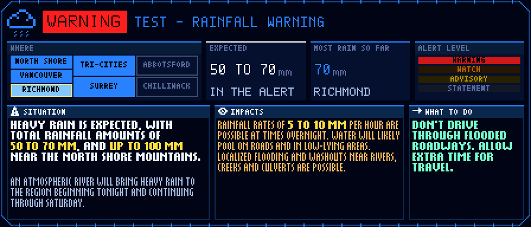<br><sub><b>Instrument Deck</b><br>Instrument deck · Envy Code &amp; Haxor · Midnight · Notched tech frame · Scan bar</sub></td></tr>
<tr><td align="center" valign="top">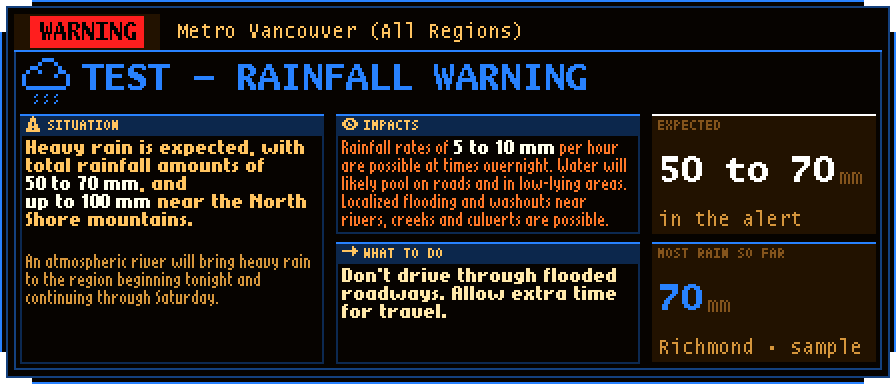<br><sub><b>Case File</b><br>Case file · Lucida Typewriter · Sodium lamp · Double rule · Typewriter</sub></td></tr>
</table>

</details>

### BC alert screens

<table>
<tr><td align="center" valign="top"><br><sub><b>Alert Ready</b><br>Alert Ready broadcast</sub></td><td align="center" valign="top">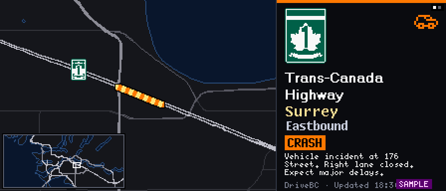<br><sub><b>DriveBC</b><br>Incident map</sub></td></tr>
<tr><td align="center" valign="top"><br><sub><b>Earthquakes</b><br>Network map</sub></td><td align="center" valign="top"><br><sub><b>Tsunami</b><br>North Pacific</sub></td></tr>
<tr><td align="center" valign="top">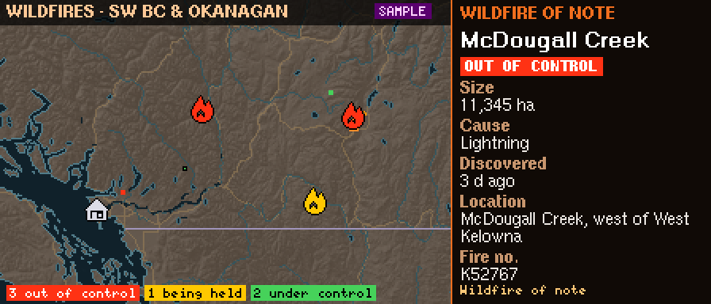<br><sub><b>Wildfire</b><br>Situation map</sub></td></tr>
</table>

<details><summary>Every BC theme</summary>

<table>
<tr><td align="center" valign="top">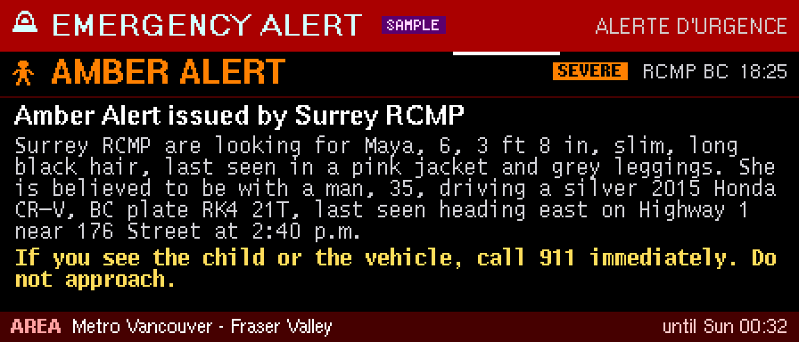<br><sub><b>Alert Ready · Alert Ready broadcast</b><br>Attention flashes, then the red EMERGENCY ALERT slab and the whole message</sub></td><td align="center" valign="top">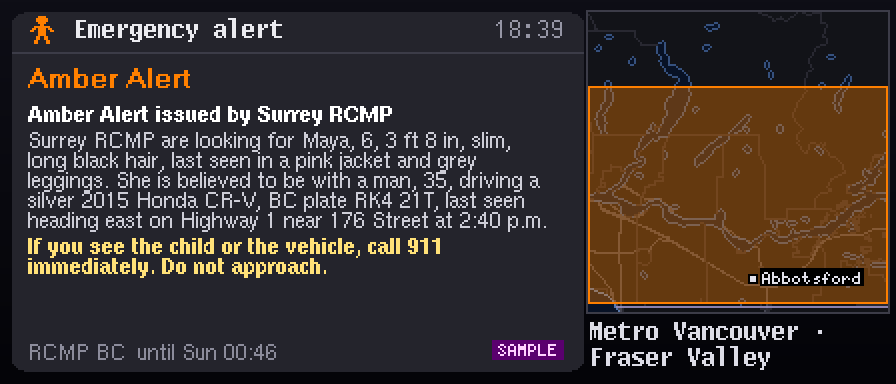<br><sub><b>Alert Ready · Phone alert</b><br>The wireless alert as a phone notification card, beside a map of the area</sub></td><td align="center" valign="top">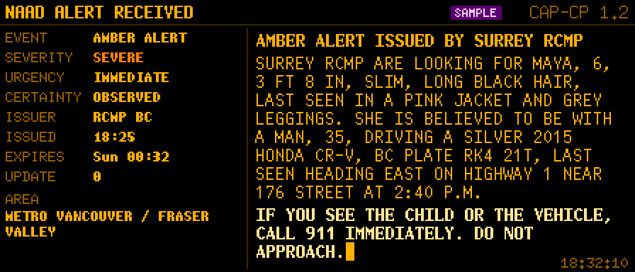<br><sub><b>Alert Ready · CAP teletype</b><br>Amber terminal: every CAP field as a table, the message typed out</sub></td></tr>
<tr><td align="center" valign="top">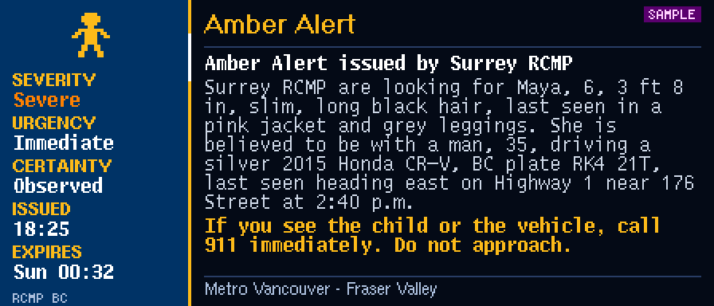<br><sub><b>Alert Ready · Provincial bulletin</b><br>BC blue and gold: a fact column, the title, the message and the areas</sub></td><td align="center" valign="top"><br><sub><b>DriveBC · Incident map</b><br>The map zoomed to the event, the affected road highlighted; shield, icon and details beside</sub></td><td align="center" valign="top">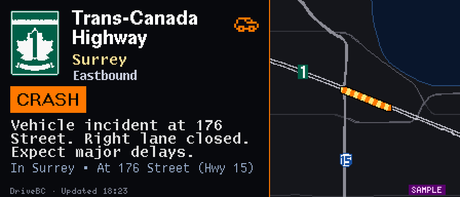<br><sub><b>DriveBC · Shield headline</b><br>A 64-px shield, the road and what is wrong in large type; the map beside</sub></td></tr>
<tr><td align="center" valign="top">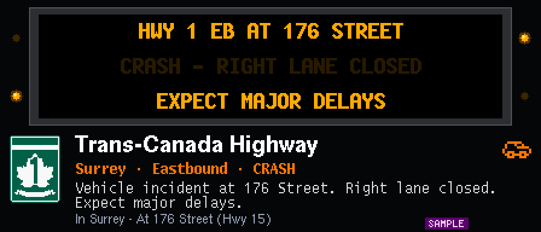<br><sub><b>DriveBC · Overhead sign</b><br>An amber variable-message sign; the big shield, icon and details beneath</sub></td><td align="center" valign="top">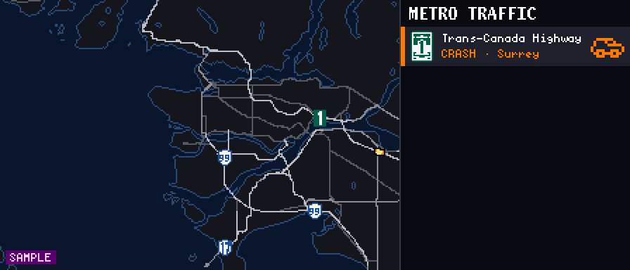<br><sub><b>DriveBC · Metro overview</b><br>Every current event's road highlighted on the Metro map, the list beside</sub></td><td align="center" valign="top">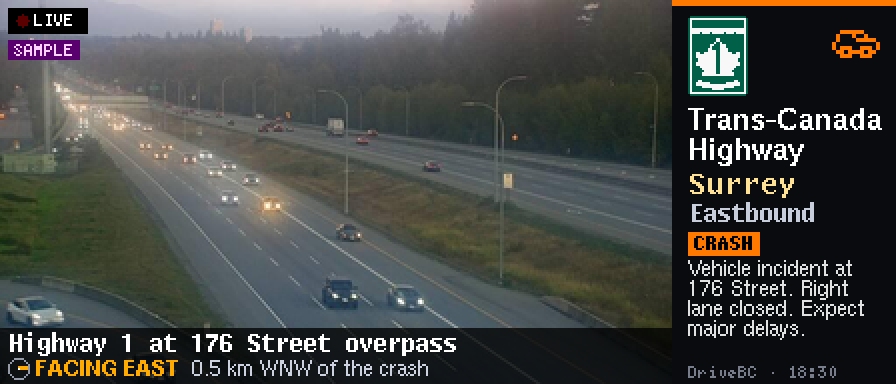<br><sub><b>DriveBC · Highway camera</b><br>The nearest DriveBC camera full height (or the map), shield and details beside</sub></td></tr>
<tr><td align="center" valign="top">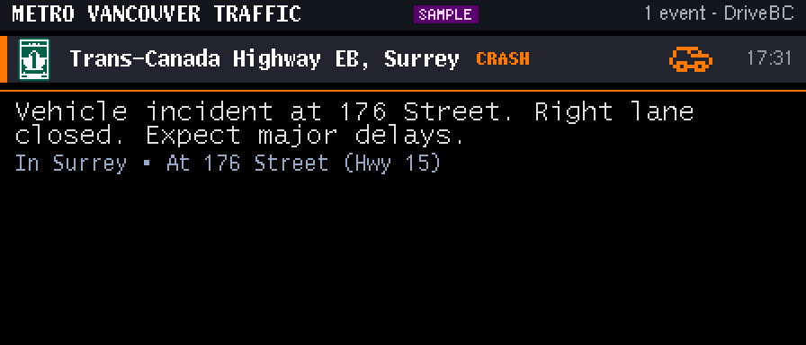<br><sub><b>DriveBC · Traffic desk</b><br>Every current event in rows with shields; the one in focus expanded below</sub></td><td align="center" valign="top">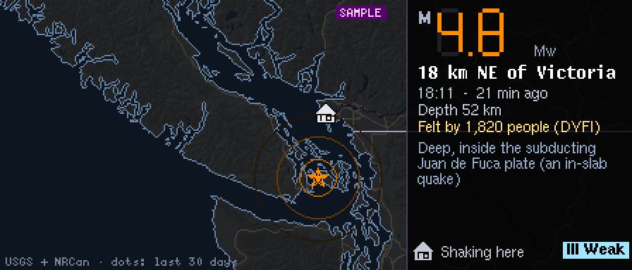<br><sub><b>Earthquakes · Network map</b><br>Epicentre, 30 days of background quakes and distance rings round home; facts panel</sub></td><td align="center" valign="top">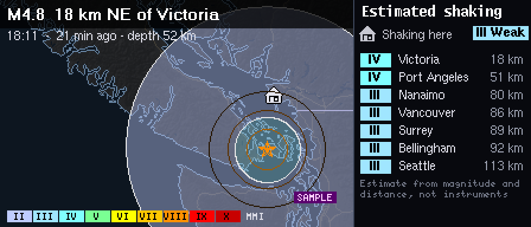<br><sub><b>Earthquakes · ShakeMap</b><br>Estimated intensity field in ShakeMap colours, with a city table</sub></td></tr>
<tr><td align="center" valign="top">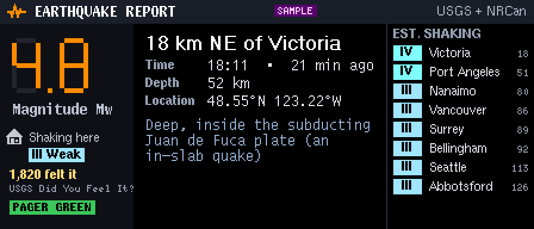<br><sub><b>Earthquakes · Earthquake report</b><br>Report card: magnitude, place, time, depth, setting, felt reports, city intensities</sub></td><td align="center" valign="top"><br><sub><b>Earthquakes · Early warning</b><br>DROP · COVER · HOLD ON with the warning text (always used for NRCan warnings)</sub></td><td align="center" valign="top"><br><sub><b>Tsunami · North Pacific</b><br>Epicentre, hourly travel-time rings and the wave front now; the BC coast in alert colours</sub></td></tr>
<tr><td align="center" valign="top"><br><sub><b>Tsunami · BC zones</b><br>The BC coast by notification zone A–E, tide gauge readings, first-wave times</sub></td><td align="center" valign="top"><br><sub><b>Tsunami · Bulletin</b><br>The official message: level bar, evaluation, earthquake parameters, arrivals</sub></td><td align="center" valign="top"><br><sub><b>Tsunami · Hazard sign</b><br>Tsunami sign with MOVE TO HIGH GROUND — or NO THREAT TO BC for information statements</sub></td></tr>
<tr><td align="center" valign="top"><br><sub><b>Wildfire · Situation map</b><br>Perimeters, evacuation areas and every fire by stage of control; the item's details</sub></td><td align="center" valign="top"><br><sub><b>Wildfire · Incident card</b><br>BCWS-style card: name, size, stage of control, cause, discovery, evacuations</sub></td><td align="center" valign="top"><br><sub><b>Wildfire · Fire danger sign</b><br>The roadside danger sign with its needle on today's rating, fires and bans</sub></td></tr>
<tr><td align="center" valign="top"><br><sub><b>Wildfire · Evacuation notice</b><br>Order or alert: the area, who issued it, homes and people, the map</sub></td></tr>
</table>

</details>

### Half-width alerts

After a new alert's full-wall showings it moves to the right half of the wall.

<table>
<tr><td align="center" valign="top"><br><sub><b>Weather alert, half width</b><br>Every page in turn</sub></td><td align="center" valign="top"><br><sub><b>Alert Ready, half width</b></sub></td><td align="center" valign="top"><br><sub><b>DriveBC, half width</b></sub></td></tr>
<tr><td align="center" valign="top"><br><sub><b>Earthquakes, half width</b></sub></td><td align="center" valign="top"><br><sub><b>Tsunami, half width</b></sub></td><td align="center" valign="top"><br><sub><b>Wildfire, half width</b></sub></td></tr>
</table>

<details><summary>Every half-width theme and page</summary>

<table>
<tr><td align="center" valign="top"><br><sub><b>Weather alert · Console</b></sub></td><td align="center" valign="top"><br><sub><b>Weather alert · Headline</b></sub></td><td align="center" valign="top"><br><sub><b>Weather alert · Ticket</b></sub></td><td align="center" valign="top"><br><sub><b>Weather alert · Checklist</b></sub></td></tr>
<tr><td align="center" valign="top"><br><sub><b>Weather alert · Big Numbers</b></sub></td><td align="center" valign="top"><br><sub><b>Weather alert · Overhead Sign</b></sub></td><td align="center" valign="top"><br><sub><b>Weather alert · Teletype</b></sub></td><td align="center" valign="top"><br><sub><b>Weather alert · Colour Block</b></sub></td></tr>
<tr><td align="center" valign="top"><br><sub><b>Weather alert · Now Expect Do</b></sub></td><td align="center" valign="top"><br><sub><b>Weather alert · Strip</b></sub></td><td align="center" valign="top"><br><sub><b>Weather alert · Level Rail</b></sub></td><td align="center" valign="top"><br><sub><b>Weather alert · Instrument Deck</b></sub></td></tr>
<tr><td align="center" valign="top"><br><sub><b>Weather alert · Case File</b></sub></td><td align="center" valign="top"><br><sub><b>Alert Ready · page 1</b></sub></td><td align="center" valign="top"><br><sub><b>Alert Ready · page 2</b></sub></td><td align="center" valign="top"><br><sub><b>Alert Ready · page 3</b></sub></td></tr>
<tr><td align="center" valign="top"><br><sub><b>Alert Ready · page 4</b></sub></td><td align="center" valign="top"><br><sub><b>DriveBC · page 1</b></sub></td><td align="center" valign="top"><br><sub><b>DriveBC · page 2</b></sub></td><td align="center" valign="top"><br><sub><b>DriveBC · page 3</b></sub></td></tr>
<tr><td align="center" valign="top"><br><sub><b>Earthquakes · page 1</b></sub></td><td align="center" valign="top"><br><sub><b>Earthquakes · page 2</b></sub></td><td align="center" valign="top"><br><sub><b>Earthquakes · page 3</b></sub></td><td align="center" valign="top"><br><sub><b>Tsunami · page 1</b></sub></td></tr>
<tr><td align="center" valign="top"><br><sub><b>Tsunami · page 2</b></sub></td><td align="center" valign="top"><br><sub><b>Tsunami · page 3</b></sub></td><td align="center" valign="top"><br><sub><b>Wildfire · page 1</b></sub></td><td align="center" valign="top"><br><sub><b>Wildfire · page 2</b></sub></td></tr>
<tr><td align="center" valign="top"><br><sub><b>Wildfire · page 3</b></sub></td></tr>
</table>

</details>

### Japan earthquake early warning

<table>
<tr><td align="center" valign="top"><br><sub><b>Kyoshin Monitor</b><br>Tokyo Bay test scenario, 4–24 s after origin</sub></td></tr>
</table>

<details><summary>All EEW themes</summary>

<table>
<tr><td align="center" valign="top"><br><sub><b>Kyoshin Monitor</b><br>Station dots and waves; epicentre, magnitude, Tokyo countdown, seismograph</sub></td><td align="center" valign="top"><br><sub><b>JQuake style</b><br>Bulletin card (規模 / 深さ / 最大震度), Tokyo dial, intensity meter</sub></td><td align="center" valign="top"><br><sub><b>TV broadcast</b><br>Full-wall map, red title box, bulletin panel, crawl</sub></td></tr>
<tr><td align="center" valign="top"><br><sub><b>LED countdown</b><br>Giant seven-segment seconds until the S wave reaches Tokyo</sub></td><td align="center" valign="top"><br><sub><b>Departure board</b><br>Amber railway-board rows: epicentre, magnitude, depth, Tokyo</sub></td><td align="center" valign="top"><br><sub><b>Pachinko</b><br>Ticker, shaking map, slot reel, katakana banner, graphs, seismograph</sub></td></tr>
<tr><td align="center" valign="top"><br><sub><b>Fever mode</b><br>Full-wall map, every panel floating on it, two tickers, rainbow</sub></td><td align="center" valign="top"><br><sub><b>Data terminal</b><br>Green CRT with Tokyo / station readouts and a live data log</sub></td><td align="center" valign="top"><br><sub><b>号外 extra edition</b><br>Newspaper extra: vertical mincho headlines, Tokyo, seismograph</sub></td></tr>
<tr><td align="center" valign="top"><br><sub><b>Seismograph lab</b><br>The nearest station's trace, traces at the strongest cities, Tokyo</sub></td><td align="center" valign="top"><br><sub><b>Arcade cabinet</b><br>Neon rings, Retro Pixel scoreboard, katakana banner, chasing lights</sub></td><td align="center" valign="top"><br><sub><b>Instrument panel</b><br>Tokyo countdown dial, intensity meter, histogram, M updates</sub></td></tr>
</table>

</details>

### Control panel

<table>
<tr><td align="center" valign="top"><br><sub><b>Overview</b></sub></td><td align="center" valign="top"><br><sub><b>Rotation</b></sub></td></tr>
<tr><td align="center" valign="top"><br><sub><b>Weather maps</b></sub></td><td align="center" valign="top"><br><sub><b>Weather alerts</b></sub></td></tr>
<tr><td align="center" valign="top"><br><sub><b>Alert Ready</b></sub></td><td align="center" valign="top"><br><sub><b>DriveBC</b></sub></td></tr>
<tr><td align="center" valign="top"><br><sub><b>Earthquakes</b></sub></td><td align="center" valign="top"><br><sub><b>Japan EEW</b></sub></td></tr>
<tr><td align="center" valign="top"><br><sub><b>Fonts</b></sub></td><td align="center" valign="top"><br><sub><b>Colour scales</b></sub></td></tr>
<tr><td align="center" valign="top"><br><sub><b>Display</b></sub></td></tr>
</table>
<!-- /gen:gallery -->

## The build

The full story is in **[docs/BUILD.md](docs/BUILD.md)**: panels, power, wiring, the frame, and the tuning that got
21 panels to a flicker-free 120 Hz.

| | |
|---|---|
| Panels | 21 × 64 × 64 HUB75 RGB panels in 3 parallel chains of 7 (448 × 192 px) |
| Controller | Raspberry Pi 4 Model B, Raspberry Pi OS 64-bit (Debian 12), boot line `isolcpus=2,3` |
| Driver | [rpi-rgb-led-matrix](https://github.com/hzeller/rpi-rgb-led-matrix), `regular` mapping, 3 parallel outputs |
| Tuning | `gpio_slowdown 3`, `pwm_bits 8`, `pwm_lsb_nanoseconds 100`, `pwm_dither_bits 1`, refresh capped at 120 Hz |
| Server | Intel N100 mini PC, Debian 13, runs the hub (FastAPI + Uvicorn) |

## Running it

You need two machines on the same network, each with a checkout of the repo: the server runs the hub, the Pi runs
the display.

```bash
# Server: hub + control panel on :8800 (runtime state lives in ~/bigscreen-state, never in the repo)
python3 -m venv .venv && .venv/bin/pip install -r requirements-hub.txt
sudo bash deploy/server-bootstrap.sh      # systemd unit, narrow sudo rules
sudo bash deploy/deploy-setup.sh          # pull-based deploys from GitHub main

# Pi: builds rpi-rgb-led-matrix with the SetBuffer patch and installs bigscreen-display
bash deploy/pi-setup.sh
```

No hardware? The renderer runs anywhere and serves its frames over HTTP:

```bash
BIGSCREEN_DATA_DIR=/path/to/data python -m display.main --emulate --port 8799   # then open :8799/frame.png
```

## Development workflow

BigScreen is a solo project built with AI coding agents, run like a small team:

- `main` is protected. Every change arrives as a pull request from a short-lived branch, with linear history,
  squash merges and required checks ([CI](.github/workflows/ci.yml): Python compile and tests, JS syntax, and a
  check that the README's generated sections are current).
- PRs with visual changes include before/after renders. A second agent reviews each PR; small changes auto-merge
  once checks pass, and bigger or riskier ones wait for my OK.
- Deploys are pull-based, with no self-hosted runner. A systemd timer on the server fast-forwards to GitHub `main`,
  restarts the hub and updates the Pi; the control panel's Overview shows the deployed commit.
- `python -m tools.readme media` re-renders this README's screenshots after visual changes, and `text` refreshes
  the generated sections and the [font credits](assets/fonts/CREDITS.md).

## Credits

BigScreen builds on [rpi-rgb-led-matrix](https://github.com/hzeller/rpi-rgb-led-matrix) by Henner Zeller (GPL-2.0),
which drives the panels and whose `graphics` code `display/gfx.py` reproduces. Many of the bitmap fonts and icons
come from [u8g2](https://github.com/olikraus/u8g2) by Oliver Kraus. Weather icons are
[Meteocons](https://github.com/basmilius/weather-icons) by Bas Milius, and pixel icons are
[pixelarticons](https://github.com/halfmage/pixelarticons). Data comes from Environment and Climate Change Canada,
DriveBC, BC Wildfire Service, Alert Ready (NAAD), USGS, NRCan, NTWC, DFO, EarthScope, the IANA tz database,
timezone-boundary-builder and OpenStreetMap contributors. **[THIRD_PARTY.md](THIRD_PARTY.md)** lists every font, icon set and data source with its licence.

Licensed under the [GNU GPL v2 or later](LICENSE).
